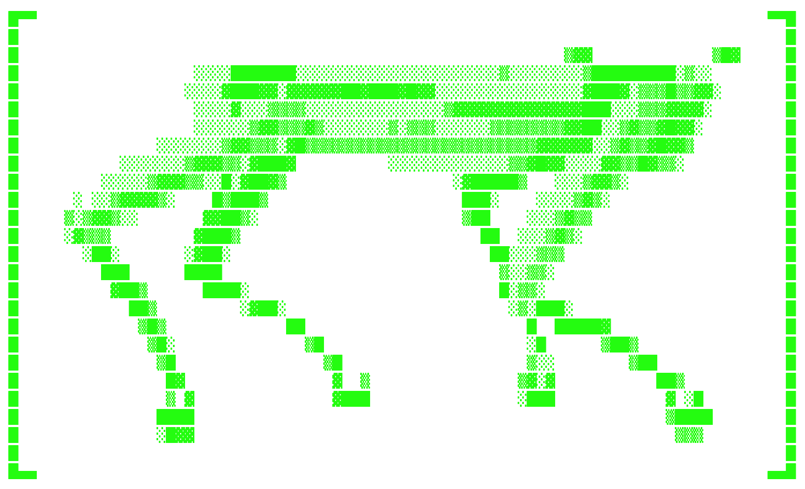

<p align="center">
  
</p>

<h1 align="center">
  <picture>
    <source media="(prefers-color-scheme: dark)" srcset="assets/title-dark.svg">
    
  </picture>
</h1>

<p align="center">
  <strong>Describe a behavior in plain English. Get a trained robot.</strong>
</p>

<p align="center">
  
  
  
  
  
  
</p>

<p align="center">
  <a href="#overview">Overview</a> ·
  <a href="#how-it-works">How it works</a> ·
  <a href="#quick-start">Quick start</a> ·
  <a href="#deploying-on-runpod">Deploying</a> ·
  <a href="#reference">Reference</a>
</p>

---

## Overview

Rewardsmith turns a sentence like *"make the robot dog walk backwards"* into a
trained policy for a simulated robot. It writes the reward function, trains the
robot on a GPU, watches the rollout video, and rewrites its own reward until the
robot does what was asked.

- **Reward functions written for you.** Claude drafts candidate rewards as Python,
  each one returning named terms you can inspect.
- **Two robots.** A Unitree Go1 quadruped and a Unitree G1 humanoid. Pick one, or
  leave it on Auto and a router chooses the body the task needs.
- **Success is measured, not guessed.** Before training, a checker writes a fixed
  pass/fail spec over rollout metrics. A candidate succeeds only if that check
  passes *and* the critic's score clears the bar.
- **Scene-aware.** Requests can include objects and terrain ("push the box into
  the zone", "climb the step"). The scene is generated first, and every reward and
  check is written against it.
- **Conversational.** Follow-ups such as *"lift your feet higher"* or *"keep going"*
  revise the best reward and continue training from its policy.
- **Live board.** Every candidate's video, reward terms, code diff, check results and
  critique appear in a browser dashboard as they arrive.

Built from scratch at **Cal Hacks 13.0** (October 23–25, 2026).

## How it works

| Stage | Model | What it does |
|---|---|---|
| **Body router** | Claude | When the robot is left on Auto, picks the body whose capabilities the task needs. |
| **Scene writer** | Claude | Turns the request into a scene spec (objects, terrain), unless one was supplied. |
| **Checker** | Claude | Writes an immutable success check over rollout metrics before any training. |
| **Writer** | Claude | Drafts *K* candidate reward functions for the first round. |
| **Editor** | Factory Droid or Claude | On follow-ups and later rounds, revises the best reward and shows the diff. |
| **Gate** | — | Compiles each reward and runs a short rollout; errors go back to the writer. |
| **Training** | — | PPO (Brax) in MuJoCo Playground, warm-started from a pretrained walker for the chosen robot. |
| **Live coach** | Claude Haiku | Watches training curves and comments on the board while candidates train. |
| **Check + critic** | Claude | Runs the success check; the critic watches rollout frames and scores 0–10. |
| **Ranking** | — | Candidates rank by whether they passed the check, then by score. |

### Modes

Each message runs in one of two modes, defined in [`rewardsmith/modes.py`](rewardsmith/modes.py).
A new task defaults to **Effort**; a follow-up defaults to **Instant**.

| Mode | Rewards per round | Model | Training steps | Live coach | Target time (RTX 4090) |
|---|---|---|---|---|---|
| **Instant** | 1 | Claude Sonnet 5.5 | 3M | Off | Under 2 minutes |
| **Effort** | 4, trained side by side | Claude Opus 5.5 | 5M | On | Under 5 minutes |

Further rounds come from follow-ups, which revise the best candidate and train on
from its policy (4M steps by default).

The message composer also accepts **Training steps (millions)**. Leave it blank for
the mode defaults, or set 1–100M to use that budget for each candidate, including
candidates continuing a saved policy. It overrides both the mode cap and the
automatic scene plan. API callers can pass `training_steps` on either
request-creation route; it is saved with the request, so pause and resume keep it.
PPO rounds up to complete training blocks, so the actual count can be slightly
higher. More steps cost more GPU time and do not guarantee that a reward learns the
requested behavior.

### Architecture

Everything runs on a single Runpod GPU pod. A FastAPI server (API and the board)
and a worker process share one SQLite database. The pod's proxy URL serves the
board publicly.

## Quick start

Fake mode returns canned rewards and synthetic metrics, so the full loop and the
board run on a laptop with no GPU and no API key.

```sh
uv venv --python 3.11 .venv
uv pip install --python .venv/bin/python -e ".[dev]"
cp .env.example .env                     # FAKE_SIM=1 and FAKE_LLM=1 by default

.venv/bin/rewardsmith-server             # API on :8000
.venv/bin/rewardsmith-worker             # in a second terminal
cd web && npm install && npm run dev     # board on :5173
```

To use real Claude calls with the fake simulator, set `REWARDSMITH_FAKE_LLM=0` and
`ANTHROPIC_API_KEY`. To try the reward writer on its own:

```sh
.venv/bin/python scripts/try_writer.py "walk backwards"
```

### Configuration

Settings are read from `.env` in the working directory; exported variables take precedence.

| Variable | Default | Purpose |
|---|---|---|
| `ANTHROPIC_API_KEY` | — | Claude API key (required when `REWARDSMITH_FAKE_LLM=0`). |
| `FACTORY_API_KEY` | — | Factory API key (required for the Droid editor). |
| `REWARDSMITH_FAKE_SIM` | `1` | `1` uses fake training and metrics; `0` trains on the GPU. |
| `REWARDSMITH_FAKE_LLM` | `1` | `1` uses canned rewards and critiques; `0` calls Claude. |
| `REWARDSMITH_EDITOR` | `claude` | Who revises rewards: `claude` or `droid`. |
| `REWARDSMITH_SUCCESS_SCORE` | `8` | Critic score (0–10) at which a run stops early. Set `11` to always run every round. |
| `REWARDSMITH_HOME` | `.rewardsmith` | Location of the SQLite database and rendered videos. |

See [`.env.example`](.env.example) for the full list.

## Deploying on Runpod

The full fresh-pod runbook, step by step with timings, is in [docs/deploy.md](docs/deploy.md).
In short, on an RTX 4090 pod with HTTP port `8000` exposed and the repository cloned
under `/workspace`:

```sh
bash scripts/runpod_setup.sh      # prints `jax backend: gpu`
bash scripts/fetch_walkers.sh     # pretrained Go1 and G1 walkers into /workspace/pretrained
bash scripts/pod/build_web.sh     # installs Node and builds web/dist
# add ANTHROPIC_API_KEY=... to .env
bash scripts/pod/start_live.sh    # server and worker, real simulator and Claude
```

Then open `https://<pod-id>-8000.proxy.runpod.net`.

## Factory Droid as the reward editor

With `REWARDSMITH_EDITOR=droid`, [Factory Droid](https://factory.ai) revises rewards
on follow-up turns and on any round after the first.

- **Input.** For each reward being revised, the worker gives Droid that reward, the
  critic's notes, the rollout metrics and every earlier attempt.
- **Sandbox.** Each revision runs in a fresh folder holding only those files, with the
  reward copied *K* times (`candidate_0.py`, …). Droid runs at low autonomy with shell
  commands disabled. It may edit files there; anything else is refused because no
  permission handler is attached.
- **Output.** Each edited candidate is read back and its diff is shown on the board,
  together with Droid's one-line reason for the change. Untouched files are dropped.

To try it on its own: `pip install -e ".[droid]"`, add `FACTORY_API_KEY` to `.env`,
then run `.venv/bin/python scripts/try_droid.py`. The folders Droid worked in are kept
under `.rewardsmith/artifacts/droid/`.

## Reward contract

Every generated reward is a Python module defining:

```python
def reward(state, action, prev_action) -> dict[str, jax.Array]:
    ...
```

It returns named terms. The trainer sums them, and the board shows each one
separately, which makes reward hacking easy to spot.

## Project structure

| Path | Contents |
|---|---|
| [`rewardsmith/orchestrator.py`](rewardsmith/orchestrator.py) | The worker loop: scene, check, write, gate, train, critique |
| [`rewardsmith/agents/`](rewardsmith/agents/) | Body router, scene writer, checker, writer, Droid and Claude editors, coach, critic, fakes |
| [`rewardsmith/sim/`](rewardsmith/sim/) | Playground environment, reward injection, training, rendering, metrics |
| [`rewardsmith/sim/bodies/`](rewardsmith/sim/bodies/) | The robot bodies (Go1, G1) and their registry |
| [`assets/walkers/`](assets/walkers/) | Pretrained walker policies |
| [`rewardsmith/modes.py`](rewardsmith/modes.py) | Instant and Effort settings |
| [`rewardsmith/server.py`](rewardsmith/server.py), [`db.py`](rewardsmith/db.py) | REST API and SQLite storage |
| [`rewardsmith/bench/`](rewardsmith/bench/) | Benchmark behaviors and their fixed checks |
| [`web/`](web/) | The board (React + Vite) |
| [`scripts/`](scripts/) | Setup, benchmark, regression and standalone tools |
| [`docs/`](docs/) | Design notes: [deployment](docs/deploy.md), [robot bodies](docs/bodies.md), [warm starts](docs/warm-start.md) |

## Reference

### Tests

```sh
.venv/bin/python -m pytest -q
```

<details>
<summary><strong>Scene-aware success checks</strong></summary>

<br>

The checker sees the generated scene before training. For reaching a fixed object
or entering a zone, checks use `target_reached` and `target_fell`, measured across
32 fresh episodes of up to 10 seconds. The default criteria are at least 80%
reaching the target and at most 10% falling. Inclusive comparisons (`>=`, `<=`)
make those thresholds explicit. A robot may reach the target and stop; continued
forward speed is not required. Missing or non-finite measurements fail their clauses.

The fixed spec is used for candidate ranking, early stopping and the stored success
result. The board displays each clause's measured value, threshold and outcome.
Checks remain immutable; an old spec missing the scene objective is retained but
marked unverified. Checker errors and unsupported tasks also remain unverified.

Scene success also supports named per-episode outcomes:

| Outcome | Passes when |
|---|---|
| `push:box:zone` | A movable object starts outside the zone, moves at least 0.1 m while the robot is nearby, settles fully inside for 0.5 s and remains inside at termination. Containment includes object size; touching is not enough. |
| `climb:step` | The upright robot is above the box top with at least two feet in contact with its top surface, sustained for 0.5 s. |
| `stand_on:step` | The robot is supported on the step and stationary for 1 s. |
| `avoid:obstacle` | Conservative swept planar clearance of the robot and feet around the obstacle throughout the episode, plus at least 0.5 m of progress. Standing still cannot pass. |
| `all:reach:goal&avoid:obstacle` | Both objectives hold in the same episodes. |
| `sequence:reach:ball>climb:step>stand_on:step` | Stages complete in order, with fresh holding intervals after each. `@SECONDS` sets an explicit hold of up to 10 s, e.g. `stand_on:step@2`. The whole sequence must fit in the 10 s evaluation. |

Avoidance and pushing use geometry, proximity and displacement rather than
contact-force attribution. Named objects are validated against the generated scene:
only movable objects can be pushed into zones, and only fixed boxes can be climbed.
Event rates default to `>= 0.8` with `scene_fell <= 0.1`. Measurements after the first
termination never count, and invalid telemetry fails closed. Each candidate gets a
small `scene_evaluation.json` with per-episode results and completion times. Plans
are sent to cold and warm training processes; the fake simulator synthesizes rates
for UI development and does not demonstrate real task performance.

The checker does not reject task classes by keyword. Claude receives an event
catalog for the scene and composes checks; the fake checker handles common English
action phrases. Requests beyond the event vocabulary remain unverified rather than
being weakened. Real MuJoCo contact tests validate scripted pushing, platform
support, avoidance and goal ordering. GPU rollout checks cover JAX and Warp in
separate processes, matching worker isolation. These checks validate measurements,
not learned-policy reliability; a verification-on/off performance comparison
remains future work.

</details>

<details>
<summary><strong>Benchmark</strong></summary>

<br>

`scripts/benchmark.py` runs the benchmark behaviors through the full loop (Claude
and training, like any request) and reports: success rate after round 1 vs. by the
last round, median rounds to success, generated vs. hand-written forward walking,
and GPU minutes per learned behavior. It also reports how often the critic's score
agreed with the check.

```sh
python scripts/benchmark.py queue                    # on the pod, with the worker running
python scripts/benchmark.py report --wait --gpu-dollars-per-hour 0.69
```

Each behavior gets a fixed success check from `rewardsmith/bench/suite.py`, stored
with the request so the checker can't change it. Success means the check passed,
not the critic's score. `limp` and `pronk` need foot-contact metrics the rollout
doesn't report yet, so they are skipped and listed as unmeasured. Three other checks
use stand-in measurements (spin drift, `run_fast` fall rate, `hind_stand` pitch);
the report says how. Results are written next to the manifest in
`<REWARDSMITH_HOME>/benchmark/`.

</details>

<details>
<summary><strong>Quality regression suite</strong></summary>

<br>

`scripts/regression.py` trains three fixed rewards (walk backwards, walk forward and
spin in place, all in `examples/rewards/`) with the `round` preset and seed 0,
through the same `PlaygroundSimulator.run_many` path the worker uses. For each it
records the final `episode_reward`, a behavior check from the rollout metrics
(e.g. `forward_velocity < -0.3` and `fell < 0.5`), `compile_s`, `train_s` and wall
time. A compare fails a case if its behavior check fails or its `episode_reward`
is more than 5% below `regression/baseline.json`. Timings are printed with their
change from the baseline but never fail the run.

Warp training isn't bit-deterministic: the same code and seed can end 10% lower, or
collapse outright, in a single run. So each case trains 3 times side by side
(`--repeats`) and is judged on the median `episode_reward` and on the behavior check
passing in at least 2 of the 3 runs. The output lists every run's reward. The
walking cases repeat within 0.2 reward and gate the run. `spin_in_place` is advisory:
on unchanged code its training reward ranges from about 15 to 29, and a whole set of
3 runs has fallen 2 out of 3 times. A spin regression therefore prints `WARN` and the
run still passes (`REGRESSION PASS (1 advisory warning)`). Review it, but don't block
a PR on it alone.

To check that a branch doesn't hurt quality, copy it to your own folder on the GPU
pod and run the compare under the shared GPU lock (about 13 minutes). The copy has
no `.git`, so pass your commit for the report:

```sh
rsync -a --exclude .venv --exclude .git --exclude node_modules --exclude .rewardsmith --exclude __pycache__ ./ pod:/workspace/<you>/
cd /workspace/<you>
flock /workspace/gpu.lock env MUJOCO_GL=egl REWARDSMITH_GIT_SHA=<your short sha> \
    /workspace/rewardsmith/.venv/bin/python scripts/regression.py --compare
```

The baseline (RTX 4090, Warp) was recorded with the rollout sampling the policy's
actions, as Brax's own evaluation does. A deterministic rollout makes the spin policy
fall, so `spin_in_place` fails its check on any branch without that render change.

The script exits 1 and prints `REGRESSION FAIL` with the reasons if any case
regressed. `--only walk_forward` runs a subset. Videos, logs and `last_run.json` go
to `.rewardsmith/regression/`. The script puts its own checkout first on the import
path, for itself and the training subprocesses, so it tests your branch's code even
though the shared venv has `/workspace/rewardsmith` installed.

Re-record the baseline (`--record`, then commit `regression/baseline.json`) only
when a change is meant to move the numbers, such as a new preset or new
observations, and say so in the PR. `--record` refuses to write a baseline whose
behavior checks fail.

</details>

## Team

Built at Cal Hacks 13.0 by Yihan Hong, Corey Dai, Jiacheng Liang and Joshua Zhang.

## License

Released under the [MIT License](LICENSE).
